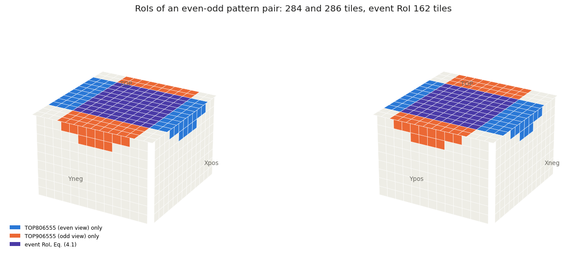
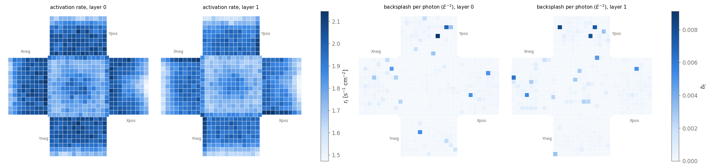
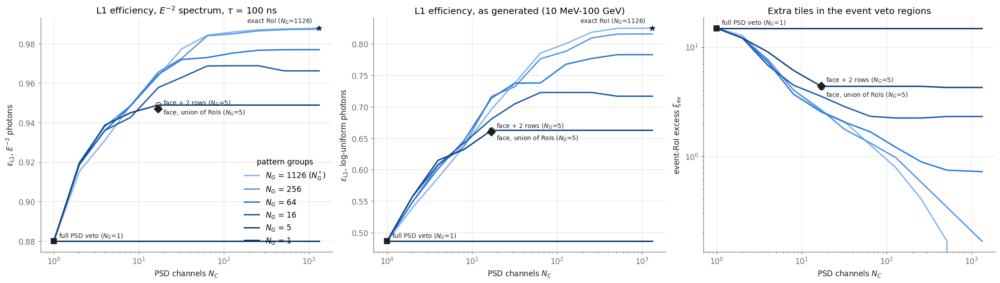

# VetoBiclustering

### How few channels does the ULEG L1 veto need? Merging 3IR patterns and PSD tiles without losing what the region-of-interest veto is for

<p align="center">
  
</p>

The ultra-low-energy gamma-ray trigger of HERD (ULEG; [thesis](#references), chapter 4) fires on **3IR patterns**, three hit FIT mats in consecutive same-view
planes, and at L1 vetoes the event when a PSD tile fires inside the pattern's **region of interest (RoI)** $\{T\}_i$: the tiles a charged particle producing
that pattern must have crossed. Vetoing on the RoI rather than the whole PSD saves the photons whose calorimeter shower splashes back onto tiles far from
the track. Implemented literally, it is one veto line per pattern listening to its own tiles: **1780 patterns and 1328 tiles** for the thesis' 3IR
definition, far beyond the channels of a trigger board. The thesis proposed instead to *"predefine groups of PSD tiles and associate them with subsets of
3IR patterns"*, for instance one veto decision per detector face extended by up to two rows of the neighbouring faces (section 4.2.2). This project
quantifies that choice and finds the best maps for any channel budget.

```
 3IR patterns i ──► N_G pattern groups g(i) ──┐
                                               ├── routing S (N_G x N_C) ──► veto mask V_it = S_{g(i) c(t)}   vs   the RoI M_it
 PSD tiles t    ──► N_C channels c(t)       ──┘
```

Both signals are merged: patterns into $N_G$ **groups** (one veto decision each), tiles into $N_C$ **channels** (an OR of tiles), and a routing $S$ says which
channels veto which group. Pattern $i$ is then vetoed by the mask $V_{it}=S_{g(i)c(t)}$ instead of its RoI $M_{it}$. Tiles in the mask but not in the RoI
cost photons (backsplash and accidental hits there now veto); tiles in the RoI but not in the mask let charged particles through.

## What kind of problem it is

- **Each tile wired to one channel** (the default here): a **co-clustering**, or biclustering, of the pattern x tile matrix $M$, hence the name. Its 0%-loss
  minimum is closed form (below).
- **A tile may feed several OR channels** (fan-out in the trigger logic): a **set cover**. The elements are the pairs (pattern, tile in its RoI), the sets
  are the all-ones blocks of $M$ (a group of patterns x a set of tiles all of them contain), and the minimum number of blocks is the minimum biclique cover,
  or Boolean rank, of $M$ (NP-hard; bounded here).
- **Under a channel budget**: a budgeted co-clustering whose errors may only add tiles to masks (no RoI tile dropped), weighted by what each added tile
  costs in photons.

## Notation and mathematics

The thesis notation is kept: 3IR patterns $i$ (even view) and $j$ (odd view of the same double layer), RoIs $\{T\}_i$, the event RoI
$\{T\}_{\rm event}=\big(\bigcup_i \{T\}^{\rm even}_i\big)\cap\big(\bigcup_j \{T\}^{\rm odd}_j\big)$ (Eq. 4.2), the L1 efficiency $\varepsilon_{\rm L1}$.
New: $M_{it}=1$ if $t\in\{T\}_i$; budgets $N_G$, $N_C$ (not $K$, $L$: $L$ would clash with the trigger levels L0-L2); excess $\xi$ and leak $\kappa$ of a mask;
per-tile backsplash $b_t$, activation rate $r_t$, coincidence window $\tau$.

- **Channels preserve the event RoI.** $V_{it}$ depends on $t$ only through its channel, so an AND per channel realises the tile-level intersection exactly,
  $\bigvee_t h_t V_{it}V_{jt}=\bigvee_l h_l S_{g(i)l}S_{g(j)l}$ ($h_l$: the OR of the channel's tiles), and the thesis' factorisation carries over channel by channel.
- **0% loss.** $V=M$ needs identical RoIs within a group and identical RoI memberships within a channel: $N_G\ge N_G^*$ = distinct rows of $M$,
  $N_C\ge N_C^*$ = distinct columns, both reached at once by grouping duplicates.
- **Below the minimum.** "Union routing" ($S_{kl}=1$ if any tile of channel $l$ is in any RoI of group $k$) never drops an RoI tile; every tile it adds costs
  photons twice: backsplash ($b_t$, steeply rising with energy) and accidental hits of the ~190 Hz per tile background inside the coincidence window,
  $q_t = 1-e^{-r_t A\tau}$. The search minimises $\sum_{it}(V-M)_{it}\,C_{it}$ with $C_{it}=-\ln\big[(1-b_t)(1-q_t)\big]$.
- **Figure of merit**: $\varepsilon_{\rm L1}$ **measured on Geant4 photons**, the fraction of L0-triggered fiducial photons that pass L1 with the map, accidentals included.

## The data

| Input | Source | Check |
|---|---|---|
| RoI of every 3IR pattern (3820; planes 0-9, all codes) | Regenerated with HerdSoftware 0.3.2 and the RoI code behind the thesis ([`data/`](data), recipe in `data/regeneration/`) | The trigger configurations of the analysis cards come out of it exactly |
| Trigger selection "thesis" (1780 patterns) | CALO intersect, third hit in the module adjacent to the first (codes 544, 546, 564, 566 removed), no upward-pointing patterns (upgoing: particle moving towards the top) | Upward-pointing patterns identified from their RoIs: low on the side faces, never reaching TOP |
| PSD activation rates per tile | Recovered from thesis Fig. 4.9, the only copy left (`tools/extractPsdRates.py`) | Mean, spread and maximum match the summary computed from the events to 0.5%, 3%, 0.2% |
| Backsplash per tile, $\varepsilon_{\rm L1}$ | The Geant4 photons that survive locally: 2 x 10^5, 10 MeV-100 GeV, upper hemisphere; 340 L0-triggered fiducial ones ([`stochastic/photonEvents.py`](stochastic/photonEvents.py)) | Weighted to $E^{-2}$, the full-PSD veto keeps 0.90 of them; thesis Table 4.2: 0.89 |

All of it is the compact-v2 layout with the earlier PSD of 10 x 10 cm tiles; the later 5 x 30 cm design is not modelled. The February 2023 RoI dump
(`data/patterns.txt`) could not be reproduced and is kept for reference only; see [`data/README.md`](data/README.md).

<p align="center">
  
</p>

## Results

**0% loss.** For the thesis selection, $N_G^*=1126$ pattern groups and $N_C^*=1326$ channels (of 1328 tiles): almost every tile sits in its own set of RoIs,
so any realistic channel count is lossy. For all 3820 patterns $N_C^*$ is all 1328 tiles.

**The thesis' strategies on Geant4 photons** ($\varepsilon_{\rm L1}$ of L0-triggered fiducial photons; $\xi_{\rm ev}$, $\kappa_{\rm ev}$: added and missing tiles of the event RoIs):

| Strategy | $N_G$ | $N_C$ | $\xi_{\rm ev}$ | $\kappa_{\rm ev}$ | $\varepsilon_{\rm L1}$, $E^{-2}$, no accidentals | $\varepsilon_{\rm L1}$, $E^{-2}$, $\tau$ = 100 ns | $\varepsilon_{\rm L1}$, $E^{-2}$, $\tau$ = 1 µs | $\varepsilon_{\rm L1}$, log-uniform, 100 ns |
|---|---|---|---|---|---|---|---|---|
| exact RoI | 1126 | 1326 | 0 | 0 | 0.990 | 0.988 | 0.970 | 0.825 |
| full PSD veto | 1 | 1 | 14.9 | 0 | 0.901 | 0.880 | 0.710 | 0.486 |
| face + 0 rows | 5 | 5 | 2.63 | **0.115** | 0.975 | 0.970 | 0.926 | 0.729 |
| **face + 2 rows (thesis)** | 5 | **17** | 4.41 | 0 | 0.955 | 0.947 | 0.881 | 0.660 |
| face, union of its RoIs | 5 | 17 | 4.30 | 0 | 0.956 | 0.949 | 0.884 | 0.663 |

- The two-row hybrid needs **17 channels, not 5**: the face masks overlap along the edges and split the tiles into 17 signatures. Per view it misses
  0.4% of the RoI tiles (side RoIs reach a third row of the neighbouring faces); in the event RoI, nothing.
- Without the neighbouring rows the veto is cheap in photons but leaks 11.5% of the event-RoI tiles.
- **The coincidence window matters as much as the layout**: at 1 µs the accidental hits equal the backsplash, and every veto loses 2-17 points.

<p align="center">
  
</p>

**Optimised maps against the budget** ($\varepsilon_{\rm L1}$, $E^{-2}$ photons, $\tau$ = 100 ns; optimised with the greedy search and local refinement):

| $N_G$ \ $N_C$ | 1326 | 256 | 64 | 32 | 17 | 8 | 4 | 1 |
|---|---|---|---|---|---|---|---|---|
| 1126 | 0.988 | 0.987 | 0.984 | 0.977 | 0.964 | 0.949 | 0.931 | 0.880 |
| 256 | 0.987 | 0.986 | 0.984 | 0.973 | 0.966 | 0.949 | 0.938 | 0.880 |
| 64 | 0.977 | 0.977 | 0.973 | 0.972 | 0.964 | 0.948 | 0.936 | 0.880 |
| 16 | 0.966 | 0.969 | 0.969 | 0.963 | 0.958 | 0.943 | 0.936 | 0.880 |
| 5 | 0.949 | 0.949 | 0.949 | 0.949 | 0.949 | 0.945 | 0.939 | 0.880 |

- **At its own budget the thesis' layout is what the optimiser finds**: no search at $N_G=5$, $N_C=17$ beats the union of each face's RoIs (0.949).
- **Beyond it, add groups, not channels**: with 5 groups nothing improves above 17 channels; 16 groups and 64 channels give 0.969, 256 groups and 64 channels 0.984.
- **One board per face costs**: confining each channel to one PSD face lowers 0.949 to 0.945 at (5, 17) and 0.943 to 0.920 at (5, 8).
- The figure of merit counts photons, not tiles. Losses grow steeply with energy: with the exact RoI veto they start above 1 GeV, with the full-PSD veto
  already at 0.2 GeV ([energy dependence](docs/figures/efficiencyVsEnergy.png), cf. thesis Fig. 4.5).

## The program

[`tools/findChannelMap.py`](tools/findChannelMap.py) finds (or evaluates) a map for any budget, trigger selection, coincidence window and hardware constraint,
and lists the combination (patterns per group, tiles per channel, routing) as text and JSON:

```
python tools/findChannelMap.py --groups 16 --channels 64 --events                          # optimise, measure on the Geant4 photons
python tools/findChannelMap.py --groups 5 --channels 17 --groups-per-fit-face \
                               --channels-per-psd-face --window 1000 --json map.json       # one board per face, 1 us window
python tools/findChannelMap.py --strategy face-rows --rows 2 --events                      # evaluate the thesis' hybrid
```

The search (greedy merges in several orders with exact merge costs, a one-group-per-face seed, local refinement) returns good local optima, not certified
ones. Hardware constraints enter as labels no merge may cross; `--cost` accepts any per-pattern, per-tile cost matrix.

## Limitations

- **Small photon sample**: 340 L0-triggered fiducial photons from the upper hemisphere. Efficiencies are good to a few percent; the backsplash map is
  smoothed and, weighted to $E^{-2}$, dominated by a few low-energy photons.
- **Background leak only geometric**: there are no charged-particle events left to measure the leak of a map; $\kappa$ counts missing RoI tiles.
- **Coincidence window**: a placeholder (100 ns); accidentals scale with it.
- **Trigger simplifications**: the calorimeter requirement is applied per pattern, not per pair, and L2 is not applied.

## Next

Exact Boolean rank by set cover over maximal bicliques; a relaxed, differentiable channel map trained by SGD in JAX; soft thresholds and soft RoIs to couple
the trigger to detector design in [AutoDetOpt](https://github.com/lfarinaa/AutoDetOpt) ([ROADMAP.md](ROADMAP.md)).

---

**Where to go next.** [`examples/channelBudgetShowcase.ipynb`](examples/channelBudgetShowcase.ipynb) (all of the above, worked through) ·
[User manual](docs/MANUAL.md) · [FINDINGS.md](FINDINGS.md) (results, and issues found in the legacy code) · [`data/README.md`](data/README.md) (provenance) ·
[`legacy/aeffcalc/`](legacy/aeffcalc) (the C++ trigger and veto algorithms).

## References

- L. Fariña Alonso, *Gamma-ray astronomy with the HERD detector onboard the Chinese Space Station*, PhD thesis, Universitat Autònoma de Barcelona (2025).
- L. Fariña et al., *Design and Performance of a Low-Energy Gamma-Ray Trigger System for HERD*, Instruments 8 (2024) 31, [doi:10.3390/instruments8020031](https://doi.org/10.3390/instruments8020031).

<sub>Work in progress by Luis Fariña; no licence yet.</sub>
