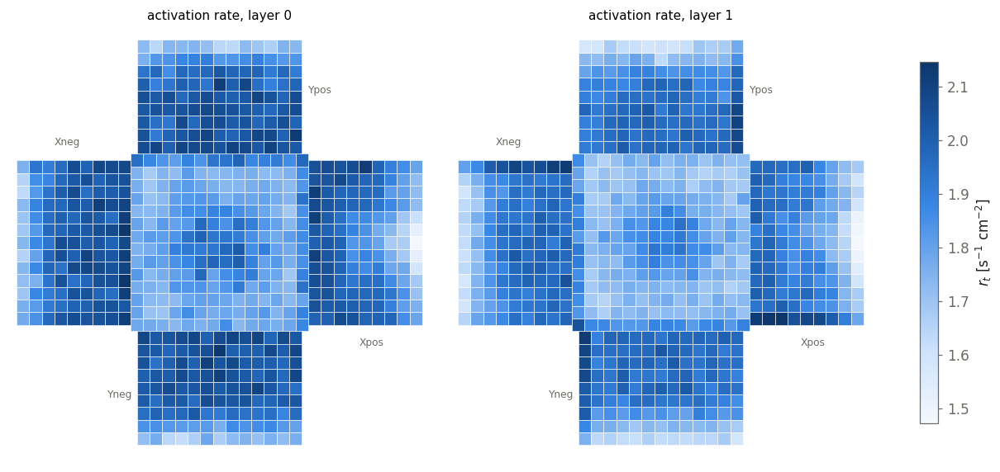
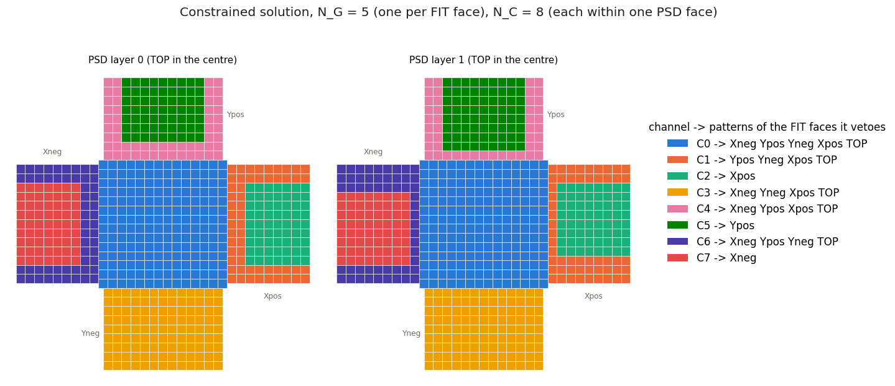
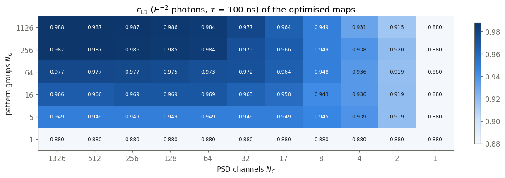
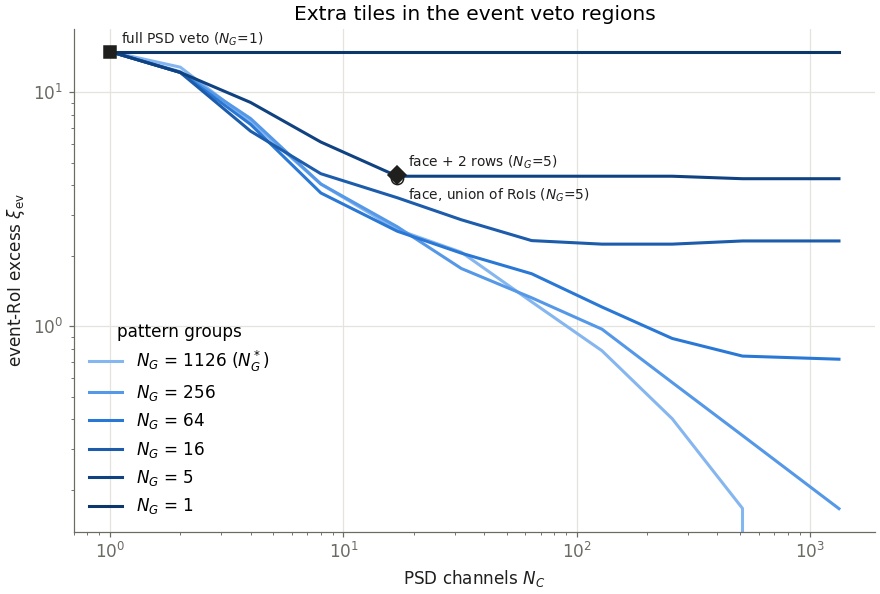

# VetoBiclustering

### How few channels does a region-of-interest veto need? Merging trigger patterns and veto elements under a channel budget

> [!NOTE]
> **Work in progress.** The analytic stage is in place: the problem, its exact 0%-loss solution, and a search that finds good (not provably optimal)
> maps for any channel budget. The stochastic stage, which takes these maps as seeds, needs a fresh simulation and is still to come ([Next](#next)).
> The code is detector-agnostic; the HERD model it is showcased on is the design of the [thesis and paper](#references), which HERD has since moved
> away from, so its numbers illustrate the method rather than predict the current instrument.

A space-borne gamma-ray telescope rejects charged particles with an **anticoincidence veto**, a segmented detector around the tracker. Vetoing on the
whole detector throws away photons whose shower splashes back onto it; a **region-of-interest (RoI) veto** lets each trigger pattern be vetoed only by
the veto elements that a charged particle producing it must have crossed. Implemented literally, that is one veto line per trigger pattern listening to
its own set of elements: thousands of patterns and elements, far beyond the channels of a trigger board. Both signals then have to be merged:

```
 trigger patterns i ──► N_G pattern groups g(i) ──┐
                                                   ├── routing S (N_G x N_C) ──► veto mask V_it = S_{g(i) c(t)}   vs   the RoI M_it
 veto elements t    ──► N_C channels c(t)       ──┘
```

patterns into $`N_G`$ **groups** (one veto decision each), veto elements (tiles, strips, ...) into $`N_C`$ **channels** (an OR of elements), and a routing $`S`$
says which channels veto which group. Pattern $`i`$ is then vetoed by the mask $`V_{it}=S_{g(i)c(t)}`$ instead of its RoI $`M_{it}`$. Elements in the mask but
not in the RoI cost signal (backsplash and accidental hits there now veto); elements in the RoI but not in the mask let charged particles through.

**VetoBiclustering** states this as a matrix problem, solves its 0%-loss case exactly and searches good maps for any budget and hardware constraint. The
core needs only the pattern x element incidence matrix (and optionally costs and labels), whatever the detector
([`tools/solveChannelMap.py`](tools/solveChannelMap.py)).

### The showcase: the HERD ULEG trigger

<p align="center">
  
</p>

The ultra-low-energy gamma-ray trigger of HERD (ULEG; [thesis](#references), chapter 4), in the design of the thesis and paper (compact-v2, PSD of 10 x 10 cm
tiles), fires on **3IR patterns**, three hit FIT mats in consecutive same-view planes, and at L1 vetoes the event when a PSD tile fires inside the
pattern's RoI $`\{T\}_i`$: **1780 patterns and 1328 tiles** for the thesis' 3IR definition. The thesis proposed to *"predefine groups of PSD tiles and
associate them with subsets of 3IR patterns"*, for instance one veto decision per detector face extended by up to two rows of the neighbouring faces
(section 4.2.2). The showcase quantifies that choice and finds good maps for any channel budget. The HERD design has changed a lot since (for one, the PSD moved
to 5 x 30 cm tiles), so the showcase is a realistic test bed for the method, not a statement about the current instrument.

## The problem

**Given** the RoI matrix $`M\in\{0,1\}^{P\times T}`$ ($`P`$ trigger patterns, $`T`$ veto elements, called tiles below; $`M_{it}=1`$ iff $`t\in\{T\}_i`$), budgets $`N_G`$, $`N_C`$, and two costs per entry,
one for each way a mask can be wrong:

- $`C^+_{it}\ge 0`$, a **false veto**: tile $`t`$ vetoes pattern $`i`$ although it is not in its RoI, and photons are lost (backsplash, accidental hits): **signal loss**;
- $`C^-_{it}\ge 0`$, a **leak**: an RoI tile of pattern $`i`$ no longer vetoes it, and charged particles get through: **more background**.

**Find**

```math
\min_{g,\,c,\,S}\;\sum_{i=1}^{P}\sum_{t=1}^{T}\Big[\,C^+_{it}\,(1-M_{it})\,V_{it} \;+\; C^-_{it}\,M_{it}\,(1-V_{it})\Big],
\qquad V_{it}=S_{g(i)\,c(t)},
```

```math
g:\{1,\dots,P\}\to\{1,\dots,N_G\},\qquad c:\{1,\dots,T\}\to\{1,\dots,N_C\},\qquad S\in\{0,1\}^{N_G\times N_C}.
```

The groups $`g`$ and channels $`c`$ cut $`M`$ into an $`N_G\times N_C`$ checkerboard of blocks, and the mask is constant on each block. For fixed partitions the
routing decouples block by block: a block is switched on iff the leaks it would cause outweigh the false vetoes,

```math
S_{kl}=1 \iff \sum_{i\in g^{-1}(k)}\;\sum_{t\in c^{-1}(l)} C^-_{it}\,M_{it}\;\ge\;\sum_{i\in g^{-1}(k)}\;\sum_{t\in c^{-1}(l)} C^+_{it}\,(1-M_{it}),
```

so the search is over the two partitions only.

**What is solved so far** is the no-leak limit $`C^-\to\infty`$: a block is on as soon as it holds one RoI tile ("union routing", $`S_{kl}=\max_{\rm block} M_{it}`$),
so $`V\ge M`$ and only the false-veto cost remains. Leak costs need charged-particle events, and none are left (see [Limitations](#limitations)).

**Problem class.** A **constrained co-clustering (biclustering)** of a binary matrix:

| Aspect | This problem |
|---|---|
| Matrix | the binary pattern x tile incidence matrix $`M`$ (1780 x 1328 in the HERD showcase), with two non-negative weight matrices $`C^\pm`$ of the same shape |
| Variables | two hard partitions, of the rows (patterns into $`N_G`$ groups) and of the columns (tiles into $`N_C`$ channels), and the block values $`S`$ |
| Model | Boolean matrix tri-factorisation $`V = G\,S\,H^\top`$ (Boolean product), $`G\in\{0,1\}^{P\times N_G}`$ and $`H\in\{0,1\}^{T\times N_C}`$ cluster-indicator matrices (one 1 per row), $`S\in\{0,1\}^{N_G\times N_C}`$: a block-constant binary approximation of $`M`$ |
| Constraints | cardinality: at most $`N_G`$ row and $`N_C`$ column clusters; optionally cannot-link labels (below); in the no-leak limit, covering $`V\ge M`$ |
| Objective | weighted asymmetric Hamming distance between $`V`$ and $`M`$: false positives (signal loss) and false negatives (background) priced separately |
| Exact solution | only at zero cost: $`V=M`$ iff $`N_G\ge N_G^*`$ = distinct rows of $`M`$ and $`N_C\ge N_C^*`$ = distinct columns |

With one side fixed it reduces to an ordinary clustering: for fixed channels, grouping the patterns is a $`k`$-clustering ($`k=N_G`$) of the rows of the
channel-level matrix, each cluster represented by a binary centre (the OR of its members in the no-leak limit, a weighted majority in general), the cost
of a point its weighted distance to that centre.

### How hard it is

**Below the 0%-loss point there is no exact solution, and the maps found here are not guaranteed to be optimal.**

- **The general problem is NP-hard.** With equal costs ($`C^+=C^-=1`$) it is the *monochromatic bi-clustering* of Wulff, Urner and Ben-David (2013),
  proven NP-hard; the weighted problem contains it. They also give an approximation scheme for that equal-cost case; whether it carries over to these
  weights is not checked here.
- **The no-leak limit**, the version solved so far, has no proof of hardness here, and no polynomial algorithm is known to us; it is treated as hard.
- **Exhaustive search is out of the question.** In the HERD showcase at $`(N_G, N_C) = (5, 8)`$ there are about $`10^{1242}`$ ways to group the 1780 patterns and $`10^{1195}`$
  ways to split the 1328 tiles. With one group per FIT face and every channel inside one PSD face, the tile splits alone still exceed $`10^{200}`$.
- **No optimality certificate.** The search (greedy merges, a one-group-per-face seed, local refinement) has no lower bound below the 0%-loss point, so
  the gap to the optimum is unknown. Two checks so far: different merge orders and seeds land on the same cost for every constrained budget below,
  and at 5 groups the search recovers the thesis' face layout on its own. Neither is a proof.

On top of this, the combinatorial problem is only a proxy: the real figure of merit is the event-level $`\varepsilon_{\rm L1}`$ with the two-view AND of
Eq. 4.2, and the real costs depend on the energy spectrum, the coincidence window and the background rates, all of which carry uncertainty.

### From analytic seeds to a stochastic optimisation

The analytic maps are the **starting point, not the end product**. The next stage uses them to seed a stochastic optimisation (simulated annealing or
basin hopping over the group and channel labels, and a relaxed, differentiable map trained by SGD) on simulated events, with a realistic,
**rate-adjusted signal and noise model**: photon losses from backsplash and accidental hits at the measured tile rates, and the leak of charged
background at the real fluxes. That stage either **verifies** the analytic maps (no move improves them) or **adjusts** them to the more realistic
objective, and sweeping the leak cost against the false-veto cost traces photon efficiency against background rejection for each budget
([ROADMAP](ROADMAP.md)).

### Other variants

Different problems, only mentioned here:

- **Fan-out** (the thesis' layout: a tile may be wired to several groups, e.g. each face's veto ORs its own tiles and the adjacent rows of its neighbours).
  Each group gets its own OR channel over any tile set (the union of its RoIs in the no-leak limit), so only the patterns are clustered: a clustering of
  the rows of $`M`$ (the special case $`N_C=T`$ above), with the budget moved into the wiring (tile-to-group links). Covering $`M`$ exactly with the fewest
  all-ones blocks is a **set cover**: the minimum biclique cover, or Boolean rank, of $`M`$, NP-complete (Orlin 1977).
- **Hardware constraints** (a channel confined to one PSD face, a group to one FIT face): the same problem with cannot-link constraints between
  differently labelled rows or columns.
- **The event-level objective**: $`\varepsilon_{\rm L1}`$ on photons, through the two-view AND of Eq. 4.2, of which the per-entry costs $`C^\pm`$ are the proxy.

## Notation and mathematics

The notation follows the thesis, where the showcase comes from: 3IR patterns $`i`$ (even view) and $`j`$ (odd view of the same double layer), RoIs $`\{T\}_i`$, the event RoI (Eq. 4.2)

```math
\{T\}_{\rm event}=\Big(\bigcup_i \{T\}^{\rm even}_i\Big)\cap\Big(\bigcup_j \{T\}^{\rm odd}_j\Big),
```

and the L1 efficiency $`\varepsilon_{\rm L1}`$. New: $`M_{it}=1`$ if $`t\in\{T\}_i`$; budgets $`N_G`$, $`N_C`$; excess $`\xi`$ and leak $`\kappa`$ of a mask; per-tile backsplash $`b_t`$, activation rate $`r_t`$, coincidence window $`\tau`$.

- **Channels preserve the event RoI.** $`V_{it}`$ depends on $`t`$ only through its channel, so an AND per channel realises the tile-level intersection
  exactly, $`\bigvee_t h_t V_{it}V_{jt}=\bigvee_l h_l S_{g(i)l}S_{g(j)l}`$ ($`h_l`$: the OR of the channel's tiles), and the thesis' factorisation carries
  over channel by channel.
- **0% loss.** $`V=M`$ needs identical RoIs within a group and identical RoI memberships within a channel: $`N_G\ge N_G^*`$ = distinct rows of $`M`$,
  $`N_C\ge N_C^*`$ = distinct columns, both reached at once by grouping duplicates.
- **Below the minimum.** Union routing (the no-leak limit) never drops an RoI tile; every tile it adds costs photons twice: backsplash ($`b_t`$, steeply
  rising with energy) and accidental hits of the ~190 Hz per tile background inside the coincidence window, $`q_t = 1-e^{-r_t A\tau}`$. Hence the
  false-veto cost $`C^+_{it}=-\ln\big[(1-b_t)(1-q_t)\big]`$, minus the log of the photon survival probability.
- **Figure of merit**: $`\varepsilon_{\rm L1}`$ **measured on Geant4 photons**, the fraction of L0-triggered fiducial photons that pass L1 with the map,
  accidentals included.

## The showcase data: HERD as in the thesis and paper

| Input | Source | Check |
|---|---|---|
| RoI of every 3IR pattern (3820; planes 0-9, all codes) | Regenerated with HerdSoftware 0.3.2 and the RoI code behind the thesis ([`data/`](data), recipe in `data/regeneration/`) | The trigger configurations of the analysis cards come out of it exactly |
| Trigger selection "thesis" (1780 patterns) | CALO intersect, third hit in the module adjacent to the first (codes 544, 546, 564, 566 removed), no upward-pointing patterns (upgoing: particle moving towards the top) | Upward-pointing patterns identified from their RoIs: low on the side faces, never reaching TOP |
| PSD activation rates per tile | Recovered from thesis Fig. 4.9, the only copy left (`tools/extractPsdRates.py`) | Mean, spread and maximum match the summary computed from the events to 0.5%, 3%, 0.2% |
| Backsplash per tile, $`\varepsilon_{\rm L1}`$ | The Geant4 photons that survive locally: 2 x 10^5, 10 MeV-100 GeV, upper hemisphere; 340 L0-triggered fiducial ones ([`stochastic/photonEvents.py`](stochastic/photonEvents.py)) | Weighted to $`E^{-2}`$, the full-PSD veto keeps 0.90 of them; thesis Table 4.2: 0.89 |

All of it is the compact-v2 layout with the earlier PSD of 10 x 10 cm tiles; the HERD design has since changed substantially (for one, 5 x 30 cm PSD tiles), and the later designs are not modelled. The February 2023 RoI dump
(`data/patterns.txt`) could not be reproduced and is kept for reference only; see [`data/README.md`](data/README.md).

<p align="center">
  
</p>

Most figures made from the Geant4 photons (backsplash map, efficiency against channels and energy) stay in the notebook until a larger simulation is
possible; the efficiencies quoted below come from the same small sample.

## Results on the HERD showcase

**0% loss.** For the thesis selection, $`N_G^*=1126`$ pattern groups and $`N_C^*=1326`$ channels (of 1328 tiles): almost every tile sits in its own set of
RoIs, so any realistic channel count is lossy. For all 3820 patterns $`N_C^*`$ is all 1328 tiles.

### The main product: a map constrained to the hardware

Five pattern groups, one per FIT face, and **8 PSD channels, each inside one PSD face** (one board per face), found by
`tools/findChannelMap.py --groups 5 --channels 8 --groups-per-fit-face --channels-per-psd-face`:

<p align="center">
  
</p>

TOP and Yneg stay whole; Xpos, Xneg and Ypos are each split into a border (the rows next to TOP and the side neighbours) and a core. With 8 channels for
5 faces only three faces can be split, so the map is not symmetric. The routing, which channels veto the patterns of each FIT face:

| Patterns of FIT face | TOP (392 tiles) | Xpos border (107) | Xpos core (127) | Yneg (234) | Ypos border (99) | Ypos core (135) | Xneg border (107) | Xneg core (127) |
|---|---|---|---|---|---|---|---|---|
| TOP | ✓ | ✓ | | ✓ | ✓ | | ✓ | |
| Xpos | ✓ | ✓ | ✓ | ✓ | ✓ | | | |
| Xneg | ✓ | | | ✓ | ✓ | | ✓ | ✓ |
| Ypos | ✓ | ✓ | | | ✓ | ✓ | ✓ | |
| Yneg | ✓ | ✓ | | ✓ | | | ✓ | |

The four constrained solutions computed so far ($`\varepsilon_{\rm L1}`$ on the Geant4 photons, $`\tau`$ = 100 ns; cost relative to the RoI-weighted total):

| $`(N_G, N_C)`$ | Constraint | Cost | $`\xi_{\rm ev}`$ | $`\varepsilon_{\rm L1}`$, $`E^{-2}`$ | $`\varepsilon_{\rm L1}`$, log-uniform |
|---|---|---|---|---|---|
| (5, 17) | groups per FIT face | 1.26 | 4.30 | 0.949 | 0.663 |
| (5, 17) | groups per FIT face, channels per PSD face | 1.75 | 6.06 | 0.945 | 0.638 |
| (5, 8) | groups per FIT face | 2.02 | 6.62 | 0.943 | 0.626 |
| **(5, 8)** | **groups per FIT face, channels per PSD face** (above) | 3.52 | 9.94 | 0.920 | 0.576 |

The full tile lists per channel come out of `tools/findChannelMap.py` (text and `--json`).

### The thesis' strategies

On the Geant4 photons ($`\varepsilon_{\rm L1}`$ of L0-triggered fiducial photons; $`\xi_{\rm ev}`$, $`\kappa_{\rm ev}`$: added and missing tiles of the event RoIs):

| Strategy | $`N_G`$ = OR channels (fan-out) | tile channels (partition) | $`\xi_{\rm ev}`$ | $`\kappa_{\rm ev}`$ | $`\varepsilon_{\rm L1}`$, $`E^{-2}`$, no accidentals | $`\varepsilon_{\rm L1}`$, $`E^{-2}`$, $`\tau`$ = 100 ns | $`\varepsilon_{\rm L1}`$, $`E^{-2}`$, $`\tau`$ = 1 µs | $`\varepsilon_{\rm L1}`$, log-uniform, 100 ns |
|---|---|---|---|---|---|---|---|---|
| exact RoI | 1126 | 1326 | 0 | 0 | 0.990 | 0.988 | 0.970 | 0.825 |
| full PSD veto | 1 | 1 | 14.9 | 0 | 0.901 | 0.880 | 0.710 | 0.486 |
| face + 0 rows | 5 | 5 | 2.63 | **0.115** | 0.975 | 0.970 | 0.926 | 0.729 |
| **face + 2 rows (thesis)** | 5 | **17** | 4.41 | 0 | 0.955 | 0.947 | 0.881 | 0.660 |
| face, union of its RoIs | 5 | 17 | 4.30 | 0 | 0.956 | 0.949 | 0.884 | 0.663 |

- The two-row hybrid is **5 OR channels with fan-out**: 2048 tile-to-group links, 624 tiles wired to two or three faces (at most 3). Without fan-out
  the same masks need 17 tile channels, since the overlaps split the tiles into 17 distinct sets. Per view it misses 0.4% of the RoI tiles (side RoIs
  reach a third row of the neighbouring faces); in the event RoI, nothing.
- Without the neighbouring rows the veto is cheap in photons but leaks 11.5% of the event-RoI tiles.
- **The coincidence window matters as much as the layout**: at 1 µs the accidental hits equal the backsplash, and every veto loses 2-17 points.

### Optimised maps against the budget

$`\varepsilon_{\rm L1}`$ of the best map found for each budget ($`E^{-2}`$ photons, $`\tau`$ = 100 ns; greedy search and local refinement). With fan-out, a map
with $`N_G`$ groups needs $`N_G`$ OR channels and the first column applies (each group vetoed by the union of its patterns' RoIs); the other columns are the
partition model with $`N_C`$ tile channels:

<p align="center">
  
</p>

<p align="center">
  
</p>

The extra tiles in the event RoIs against the budget are pure geometry (the maps themselves were optimised with the false-veto cost, which includes the
measured backsplash).

- **At its own budget the thesis' layout is what the optimiser finds**: with 5 groups the best is the union of each face's RoIs (0.949), and the
  two-row hybrid is within 0.002 of it.
- **Beyond it, add groups**: with fan-out, 16 groups give 0.966 (5120 tile-to-group links, fan-out up to 9), 64 groups 0.977 (14 953 links, up to 23),
  256 groups 0.987 (50 663 links, up to 69); the wiring, not the OR channels, becomes the cost. Without fan-out, 5 groups gain nothing above 17 tile
  channels; 16 groups and 64 channels give 0.969, 256 groups and 64 channels 0.984.
- **One board per face costs**: confining each channel to one PSD face lowers 0.949 to 0.945 at (5, 17) and 0.943 to 0.920 at (5, 8).
- The figure of merit counts photons, not tiles. Losses grow steeply with energy: with the exact RoI veto they start above 1 GeV, with the full-PSD veto
  already at 0.2 GeV (cf. thesis Fig. 4.5).

## The program

**Any detector**: [`tools/solveChannelMap.py`](tools/solveChannelMap.py) takes the incidence matrix (`.npy` or a 0/1 text file), optionally a cost matrix,
row and column labels a group or channel may not mix (one board per face, say) and names, and lists the map (patterns per group, elements per channel,
routing) as text and JSON:

```
python tools/solveChannelMap.py --matrix roi.npy --groups 8 --channels 16
python tools/solveChannelMap.py --matrix roi.csv --cost cost.npy --col-labels boards.txt --groups 5 --channels 8 --json map.json
```

**The HERD showcase**: [`tools/findChannelMap.py`](tools/findChannelMap.py) is the same search with the HERD front end: the RoI dump, trigger selections,
PSD geometry, rates, the coincidence window, and the L1 efficiency on the Geant4 photons:

```
python tools/findChannelMap.py --groups 16 --channels 64 --events                          # optimise, measure on the Geant4 photons
python tools/findChannelMap.py --groups 5 --channels 17 --groups-per-fit-face \
                               --channels-per-psd-face --window 1000 --json map.json       # one board per face, 1 us window
python tools/findChannelMap.py --strategy face-rows --rows 2 --events                      # evaluate the thesis' hybrid
```

The search (greedy merges in several orders with exact merge costs, optional seeds, local refinement) returns good local optima, not certified ones
([How hard it is](#how-hard-it-is)). The detector-specific parts live in their own modules (`patternDump`, `geometryUtils`, `rateUtils`,
`stochastic/photonEvents`); the core (`losslessUtils`, `mergeUtils`) sees only matrices.

## Limitations

- **Not provably optimal**: below 0% loss the maps are local optima of a heuristic search, with no bound on the gap.
- **Outdated showcase model**: the HERD numbers are for the thesis and paper design; the instrument has changed a lot since.
- **Small photon sample**: 340 L0-triggered fiducial photons from the upper hemisphere. Efficiencies are good to a few percent; the backsplash map is
  smoothed and, weighted to $`E^{-2}`$, dominated by a few low-energy photons.
- **Background leak only geometric**: there are no charged-particle events left to measure the leak of a map; $`\kappa`$ counts missing RoI tiles.
- **Coincidence window**: a placeholder (100 ns); accidentals scale with it.
- **Trigger simplifications**: the calorimeter requirement is applied per pattern, not per pair, and L2 is not applied.

## Next

The stochastic stage seeded by the analytic maps ([above](#from-analytic-seeds-to-a-stochastic-optimisation)), on a fresh simulation with charged
background; exact Boolean rank by set cover over maximal bicliques; soft thresholds and soft RoIs to couple the trigger to detector design in
[AutoDetOpt](https://github.com/lfarinaa/AutoDetOpt) ([ROADMAP.md](ROADMAP.md)).

---

**Where to go next.** [`examples/channelBudgetShowcase.ipynb`](examples/channelBudgetShowcase.ipynb) (all of the above, worked through) ·
[User manual](docs/MANUAL.md) · [FINDINGS.md](FINDINGS.md) (results, and issues found in the legacy code) · [`data/README.md`](data/README.md) (provenance) ·
[`legacy/aeffcalc/`](legacy/aeffcalc) (the C++ trigger and veto algorithms).

## References

- L. Fariña Alonso, *Gamma-ray astronomy with the HERD detector onboard the Chinese Space Station*, PhD thesis, Universitat Autònoma de Barcelona (2025).
- L. Fariña et al., *Design and Performance of a Low-Energy Gamma-Ray Trigger System for HERD*, Instruments 8 (2024) 31, [doi:10.3390/instruments8020031](https://doi.org/10.3390/instruments8020031).
- S. Wulff, R. Urner, S. Ben-David, *Monochromatic Bi-Clustering*, Proc. ICML 2013 (PMLR 28), [proceedings.mlr.press/v28/wulff13](https://proceedings.mlr.press/v28/wulff13.html).
- J. Orlin, *Contentment in graph theory: covering graphs with cliques*, Indagationes Mathematicae 80 (1977) 406-424.

<sub>Work in progress by Luis Fariña; no licence yet.</sub>
