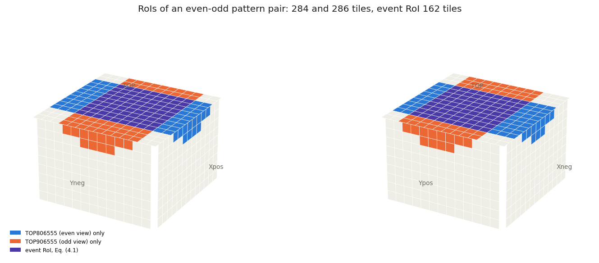
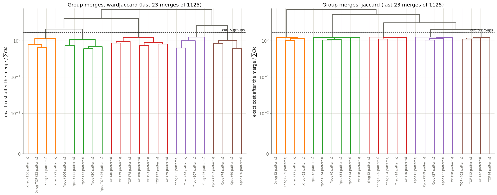
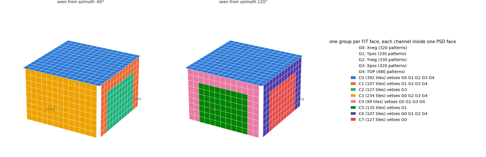

# VetoBiclustering

**Channel budgets for region-of-interest vetoes: which trigger patterns and anticoincidence tiles can share a trigger channel, and what each merge
costs in signal.**

> [!NOTE]
> **Work in progress.** The analytic stage is in place; the stochastic stage that refines its maps needs a large simulation and will follow once
> supercomputer access is available. The code works for any detector. It is shown here on the High Energy cosmic-Radiation Detection facility
> (HERD) as designed in the [thesis and paper](#references), a design HERD has since moved away from, so the HERD numbers illustrate the method
> rather than predict the current instrument. All HERD results are collected in the [HERD showcase](docs/HERD_SHOWCASE.md).

<p align="center">
  
</p>

## The idea

A space-borne gamma-ray telescope rejects charged particles with an anticoincidence detector around its tracker. Vetoing on the whole detector also
throws away photons whose shower splashes back onto it. A **region-of-interest (RoI) veto** avoids most of that loss: each trigger pattern is vetoed
only by the tiles that a charged particle producing it must have crossed (above, for one pair of HERD patterns). Wired literally, this takes one veto
line per trigger pattern, each listening to its own tiles, which for HERD means 1780 patterns and 1328 tiles, far more than a trigger board has
channels. VetoBiclustering merges the patterns into a few groups and the tiles into a few channels, and looks for the merges that lose the least.

```
 trigger patterns i ──► N_G pattern groups g(i) ──┐
                                                   ├── routing S ──► veto mask V_it = S_{g(i) c(t)}   compared with the RoI M_it
 veto tiles t       ──► N_C channels c(t)       ──┘
```

## The problem

The RoIs form a binary matrix $`M`$, with one row per trigger pattern and one column per tile. A channel map is judged by its cost, written as

```math
\mathcal{C}(g, c, S) = \sum_{i=1}^{P} \sum_{t=1}^{T} \Big[\, C^+_{it}\,(1 - M_{it})\,V_{it} \;+\; C^-_{it}\,M_{it}\,(1 - V_{it}) \Big],
\qquad V_{it} = S_{g(i)\,c(t)},
```

where
- $`M_{it}`$ is 1 when tile $`t`$ is in the RoI of trigger pattern $`i`$ and 0 otherwise, for $`P`$ patterns and $`T`$ tiles;
- $`g(i)`$ is the group of pattern $`i`$, one of $`N_G`$; $`c(t)`$ is the channel of tile $`t`$, one of $`N_C`$; $`S_{kl}`$ is 1 when channel $`l`$
  vetoes group $`k`$; so $`V_{it}`$ is 1 when tile $`t`$ vetoes pattern $`i`$ in the merged map;
- $`C^+_{it}`$ is the cost of a **false veto**, tile $`t`$ vetoing pattern $`i`$ outside its RoI: the photons lost to backsplash and accidental hits,
  dimensionless (minus the logarithm of the photon survival probability);
- $`C^-_{it}`$ is the cost of a **leak**, an RoI tile no longer vetoing its pattern: the charged background let through, dimensionless and on the
  same scale as $`C^+_{it}`$.

The search minimises $`\mathcal{C}`$ over the groups, the channels and the routing for given budgets $`N_G`$ and $`N_C`$. This is a **constrained
co-clustering (biclustering)** of a binary matrix: a block-constant binary approximation of $`M`$ with weighted, asymmetric errors. It is NP-hard
(with equal costs it is the monochromatic bi-clustering of Wulff, Urner and Ben-David 2013, proven NP-hard), and exhaustive search is impossible: there are about
$`10^{1242}`$ ways to split the 1780 HERD patterns into 5 groups alone. The maps found are therefore good, not provably optimal. Only the zero-cost
case has an exact solution, which needs as many groups as $`M`$ has distinct rows and as many channels as it has distinct columns. So far the no-leak
limit is solved ($`C^-\to\infty`$, no RoI tile ever dropped), because pricing leaks needs charged-particle events. The problem class, variants such as
fan-out wiring, and the notation are in [`docs/PROBLEM.md`](docs/PROBLEM.md).

## Two algorithms

Since neither search is guaranteed optimal, the code has two with different blind spots. The **exact-cost greedy** merges, at every step, the two
groups or channels whose merge adds the least cost, then refines the result by moving single patterns and tiles. The **Jaccard merge** is a hierarchical
clustering instead: it repeatedly joins the two most similar groups or channels, similarity being the overlap of their veto masks with a size
penalty from Ward's linkage. Patterns from nearby tracks have nearly the same RoI, so merging the most similar ones first loses little, and the
nested merges form a tree in which every budget is a cut. On HERD the tree splits the patterns along the faces of the tracker without being told
about faces:

<p align="center">
  
</p>

Neither algorithm wins everywhere: the greedy is 5 to 32% cheaper with 16 or 64 groups, the Jaccard merge about 1% cheaper with 5 groups and
3 to 4 times faster ([comparison](docs/HERD_SHOWCASE.md#the-two-algorithms-compared)). Both are kept as starting points for the next stage.

## The HERD showcase

This section gives the main result; the [**full HERD showcase**](docs/HERD_SHOWCASE.md) collects all of them.

The ULEG trigger of HERD (Ultra-Low-Energy Gamma-ray trigger; [thesis](#references), chapter 4) fires on three hits in a row in the scintillating-fibre
tracker, and vetoes on the RoI in the plastic scintillator detector (PSD) around it. Reproducing every RoI exactly would take 1126 pattern groups and
1326 channels. The main result so far is a map that fits the hardware, with one pattern group per tracker face and 8 channels that each stay inside
one PSD face:

<p align="center">
  
</p>

It keeps 92.0% of the photons that pass the first trigger level (fiducial photons weighted to an $`E^{-2}`$ spectrum, from a small Geant4
sample), against 88.0% for a veto on the whole PSD and 98.8% for the exact RoI veto. The [showcase](docs/HERD_SHOWCASE.md) has the efficiency against
the channel budget, the thesis' own layouts, the comparison of the two algorithms, the data and the limitations.

## Next

The analytic maps will seed a stochastic optimisation on simulated events, with photon losses at the measured tile rates and the leak of charged
background at the real fluxes. It either confirms the maps or adjusts them, and sweeping the leak cost against the false-veto cost traces photon
efficiency against background rejection for each budget ([ROADMAP](ROADMAP.md)).

## Getting started

```
pip install -r requirements.txt
python tools/solveChannelMap.py --matrix roi.npy --groups 8 --channels 16 --json map.json     # any detector: an RoI matrix in, a map out
```

The [manual](docs/MANUAL.md) covers the HERD front end, the notebooks in [`examples/`](examples) and every module.

## References

- L. Fariña Alonso, *Gamma-ray astronomy with the HERD detector onboard the Chinese Space Station*, PhD thesis, Universitat Autònoma de Barcelona (2025).
- L. Fariña et al., *Design and Performance of a Low-Energy Gamma-Ray Trigger System for HERD*, Instruments 8 (2024) 31, [doi:10.3390/instruments8020031](https://doi.org/10.3390/instruments8020031).
- S. Wulff, R. Urner, S. Ben-David, *Monochromatic Bi-Clustering*, Proceedings of the 30th International Conference on Machine Learning (ICML 2013), Proceedings of Machine Learning Research 28, [proceedings.mlr.press/v28/wulff13](https://proceedings.mlr.press/v28/wulff13.html).
- J. H. Ward, *Hierarchical Grouping to Optimize an Objective Function*, J. Am. Stat. Assoc. 58 (1963) 236, [doi:10.1080/01621459.1963.10500845](https://doi.org/10.1080/01621459.1963.10500845).

---

<sub>Luis Fariña. Questions, and ideas for applying this to other instruments, are welcome in the issues. No licence yet.</sub>
