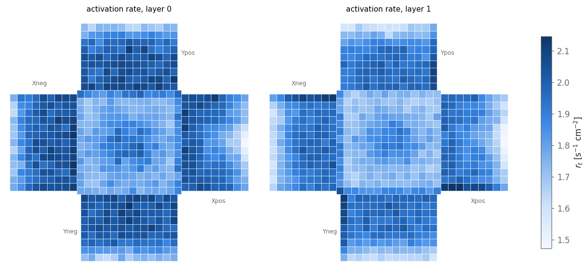
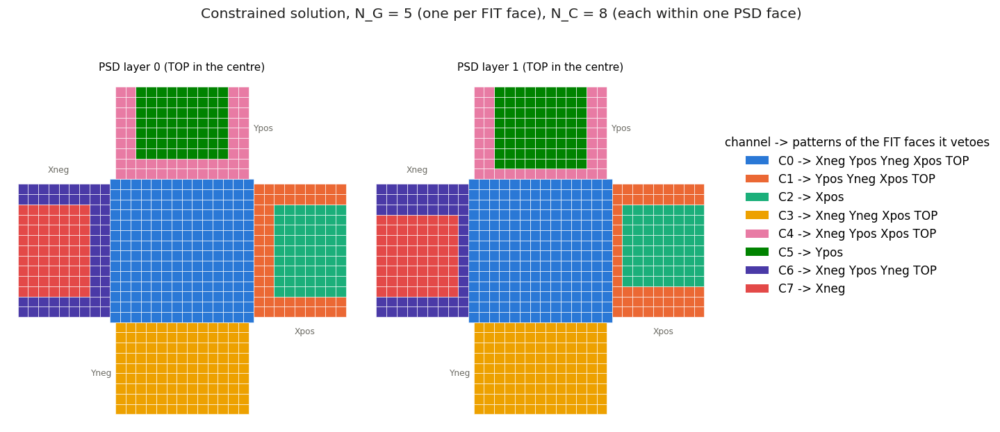
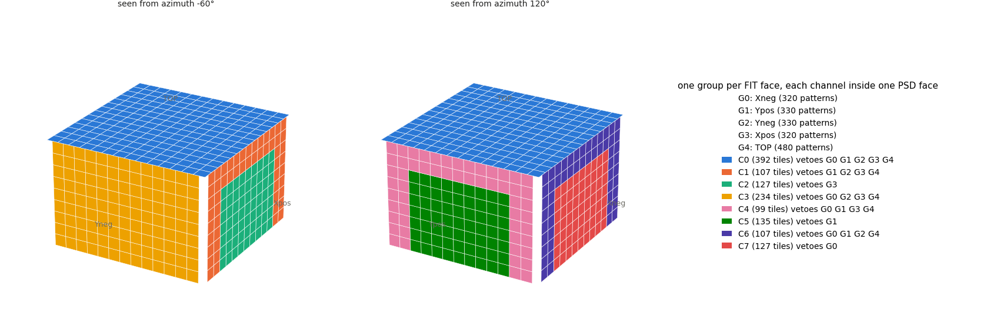
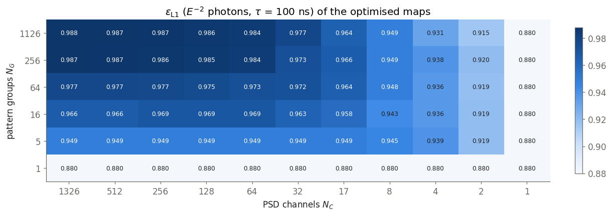
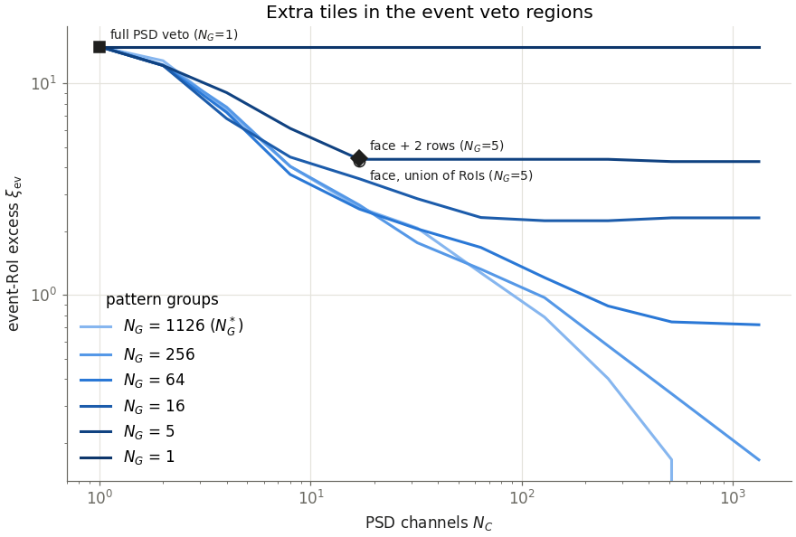
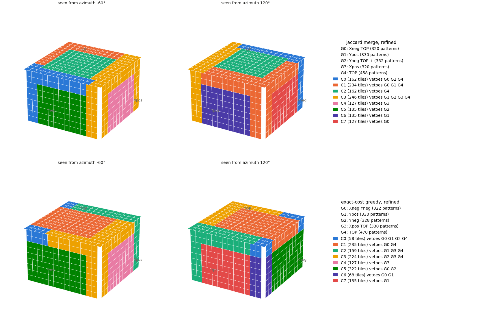
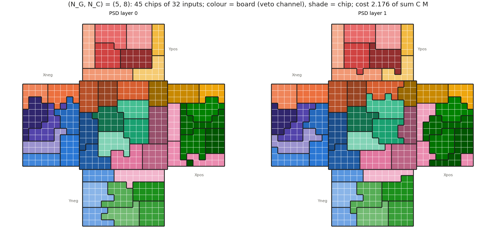

# The HERD showcase

VetoBiclustering is shown on the ultra-low-energy gamma-ray (ULEG) trigger of the High Energy cosmic-Radiation Detection facility (HERD), in the design
of the [thesis and paper](../README.md#references). The trigger fires at its first level (L0) on 3IR patterns, three hits in a row in consecutive
same-view planes of the scintillating-fibre tracker (FIT), and vetoes at its second level (L1) when a tile of the plastic scintillator detector (PSD)
fires inside the pattern's region of interest (RoI). The design has changed a lot since (the PSD, for one, moved from 10 x 10 cm to 5 x 30 cm tiles),
so these numbers illustrate the method rather than predict the current instrument. The problem and notation are in [PROBLEM.md](PROBLEM.md).

## The data

| Input | Source | Check |
|---|---|---|
| RoI of every 3IR pattern (3820 patterns; planes 0-9, all codes) | Regenerated with HerdSoftware 0.3.2 and the RoI code behind the thesis ([`data/`](../data)) | The trigger configurations of the analysis cards come out of it exactly |
| Trigger selection "thesis" (1780 patterns) | Patterns whose track, extrapolated, crosses the calorimeter (CALO intersect), with the third hit in the module adjacent to the first (codes 544, 546, 564 and 566 removed), and no upward-pointing patterns (upgoing: the particle moves towards the top) | The upward-pointing patterns are identified from their RoIs: low on the side faces, never reaching the top face |
| PSD activation rate per tile | Recovered from thesis Fig. 4.9, the only copy left (`tools/extractPsdRates.py`) | Mean, spread and maximum match the summary computed from the original events to 0.5%, 3% and 0.2% |
| Backsplash per tile, and $`\varepsilon_{\rm L1}`$ | The Geant4 photons that survive locally: 2 x 10⁵ photons, 10 MeV to 100 GeV, upper hemisphere; 340 of them pass L0 inside the fiducial region ([`stochastic/photonEvents.py`](../stochastic/photonEvents.py)) | Weighted to an $`E^{-2}`$ spectrum, the full-PSD veto keeps 0.90 of them; thesis Table 4.2 gives 0.89 |

Everything uses the compact-v2 layout with the 10 x 10 cm PSD tiles of the thesis. The February 2023 RoI dump (`data/patterns.txt`) could not be
reproduced and is kept for reference only ([`data/README.md`](../data/README.md)).

  

Most figures made from the Geant4 photons (the backsplash map, the efficiency against energy) stay in the notebooks until a larger simulation is
possible; every efficiency below comes from the same small sample, good to a few percent.

## Zero loss

Reproducing every RoI exactly needs $`N_G^* = 1126`$ pattern groups and $`N_C^* = 1326`$ channels for the 1328 tiles of the thesis selection: almost
every tile sits in its own set of RoIs, so any realistic channel count loses something. For all 3820 patterns, $`N_C^*`$ is all 1328 tiles.

## A map that fits the hardware

The main result so far has five pattern groups, one per FIT face, and 8 PSD channels that each stay inside one PSD face (one board per face). It is
found by `tools/findChannelMap.py --groups 5 --channels 8 --groups-per-fit-face --channels-per-psd-face`.

  

In 3D, seen from two sides so that all five faces show (layer 0), with the groups G0 to G4 named by their FIT faces:

  

The top face and Yneg stay whole, while Xpos, Xneg and Ypos are each split into a border (the rows next to the top face and to the side neighbours)
and a core. With 8 channels for 5 faces only three faces can be split, so the map is not symmetric. The routing table shows which channels veto the
patterns of each FIT face.

| Patterns of FIT face | TOP (392 tiles) | Xpos border (107) | Xpos core (127) | Yneg (234) | Ypos border (99) | Ypos core (135) | Xneg border (107) | Xneg core (127) |
|---|---|---|---|---|---|---|---|---|
| TOP | ✓ | ✓ | | ✓ | ✓ | | ✓ | |
| Xpos | ✓ | ✓ | ✓ | ✓ | ✓ | | | |
| Xneg | ✓ | | | ✓ | ✓ | | ✓ | ✓ |
| Ypos | ✓ | ✓ | | | ✓ | ✓ | ✓ | |
| Yneg | ✓ | ✓ | | ✓ | | | ✓ | |

The four constrained solutions computed so far are compared below. The cost is relative to the cost-weighted size of the RoIs, $`\sum_{it} C_{it}
M_{it}`$; $`\xi_{\rm ev}`$ is the number of tiles added to the event RoIs per event-RoI tile; $`\varepsilon_{\rm L1}`$ is measured on the Geant4 photons
with accidental hits in a 100 ns window, weighted either to an $`E^{-2}`$ spectrum or log-uniformly in energy as generated.

| $`(N_G, N_C)`$ | Constraint | Cost | $`\xi_{\rm ev}`$ | $`\varepsilon_{\rm L1}`$, $`E^{-2}`$ | $`\varepsilon_{\rm L1}`$, log-uniform |
|---|---|---|---|---|---|
| (5, 17) | groups per FIT face | 1.26 | 4.30 | 0.949 | 0.663 |
| (5, 17) | groups per FIT face, channels per PSD face | 1.75 | 6.06 | 0.945 | 0.638 |
| (5, 8) | groups per FIT face | 2.02 | 6.62 | 0.943 | 0.626 |
| **(5, 8)** | **groups per FIT face, channels per PSD face** (above) | 3.52 | 9.94 | 0.920 | 0.576 |

The full tile lists per channel come out of `tools/findChannelMap.py`, as text or as JSON with `--json`.

## The thesis' layouts

The thesis proposed one veto decision per FIT face, listening to its own PSD face extended by up to two rows of the neighbouring faces. The table
evaluates it and related layouts on the Geant4 photons, where $`\kappa_{\rm ev}`$ is the fraction of event-RoI tiles missing from the mask and the
channel count is given for fan-out wiring (a tile may feed several groups) and for partitioned wiring (each tile feeds one channel).

| Layout | Channels with fan-out | Channels, partitioned | $`\xi_{\rm ev}`$ | $`\kappa_{\rm ev}`$ | $`\varepsilon_{\rm L1}`$, $`E^{-2}`$, no accidentals | $`\varepsilon_{\rm L1}`$, $`E^{-2}`$, $`\tau`$ = 100 ns | $`\varepsilon_{\rm L1}`$, $`E^{-2}`$, $`\tau`$ = 1 µs | $`\varepsilon_{\rm L1}`$, log-uniform, 100 ns |
|---|---|---|---|---|---|---|---|---|
| exact RoI | 1126 | 1326 | 0 | 0 | 0.990 | 0.988 | 0.970 | 0.825 |
| full PSD veto | 1 | 1 | 14.9 | 0 | 0.901 | 0.880 | 0.710 | 0.486 |
| face + 0 rows | 5 | 5 | 2.63 | **0.115** | 0.975 | 0.970 | 0.926 | 0.729 |
| **face + 2 rows (thesis)** | 5 | **17** | 4.41 | 0 | 0.955 | 0.947 | 0.881 | 0.660 |
| face, union of its RoIs | 5 | 17 | 4.30 | 0 | 0.956 | 0.949 | 0.884 | 0.663 |

- The two-row layout of the thesis is 5 OR channels with fan-out, with 2048 tile-to-group links and 624 tiles wired to two or three faces. Without
  fan-out the same masks need 17 channels, because the overlaps split the tiles into 17 distinct sets. Per view it misses 0.4% of the RoI tiles (side
  RoIs reach a third row of the neighbouring faces), and none of the event-RoI tiles.
- Without the neighbouring rows the veto loses few photons but leaks 11.5% of the event-RoI tiles.
- The coincidence window matters as much as the layout: at 1 µs the accidental hits equal the backsplash, and every veto loses 2 to 17 points.

## Efficiency against the channel budget

The heat map gives $`\varepsilon_{\rm L1}`$ of the best map found for each budget ($`E^{-2}`$ photons, 100 ns window; exact-cost greedy search and
local refinement). With fan-out, a map with $`N_G`$ groups needs $`N_G`$ OR channels and the first column applies (each group vetoed by the union of its
patterns' RoIs); the other columns are partitioned wiring with $`N_C`$ channels.

  

The tiles added to the event RoIs depend on geometry alone (the maps themselves were optimised with the false-veto cost, which includes the measured
backsplash).

  

- At its own budget the thesis' layout is what the optimiser finds: with 5 groups the best map is the union of each face's RoIs (0.949), and the
  two-row layout is within 0.002 of it.
- Beyond it, more groups help. With fan-out, 16 groups give 0.966 (5120 tile-to-group links, up to 9 groups per tile), 64 groups 0.977 (14 953 links,
  up to 23) and 256 groups 0.987 (50 663 links, up to 69), so the wiring rather than the channel count becomes the cost. Without fan-out, 5 groups
  gain nothing above 17 channels; 16 groups with 64 channels give 0.969, and 256 groups with 64 channels 0.984.
- One board per face costs efficiency: keeping each channel inside one PSD face lowers 0.949 to 0.945 at (5, 17) and 0.943 to 0.920 at (5, 8).
- The figure of merit counts photons, not tiles, and the losses grow steeply with energy: with the exact RoI veto they start above 1 GeV, with the
  full-PSD veto already at 0.2 GeV (compare thesis Fig. 4.5).

## The two algorithms compared

The Jaccard merge ([PROBLEM.md](PROBLEM.md#the-jaccard-merge)) against the exact-cost greedy, both refined, on the few-channel budgets (cost relative
to $`\sum_{it} C_{it} M_{it}`$, lower is better):

| $`(N_G, N_C)`$ | (64, 32) | (64, 4) | (16, 17) | (16, 4) | (5, 17) | (5, 8) |
|---|---|---|---|---|---|---|
| exact-cost greedy | 0.555 | 2.983 | 0.965 | 3.181 | 1.281 | 2.069 |
| Jaccard merge | 0.602 | 3.950 | 1.018 | 3.929 | **1.264** | **2.049** |

The efficiencies of the two agree within 0.01 at most budgets, and the Jaccard maps lose up to 0.02 more at 4 channels. At (5, 8) the two
refined maps differ visibly although their costs are within 1%. Both give the core of the top face one channel and split each side face into a core
and a border ring, but the Jaccard merge gives each of the four side cores its own channel and pairs the patterns of Xneg and of Yneg with top-face
patterns, while the greedy puts the Xneg and Yneg cores into one channel (322 tiles) and groups the patterns of those two faces together. In the legends, a group named by two faces holds patterns of both, and "+"
marks a group with patterns of more faces.

  

 All 12 budgets, the merge paths
and the maps are in [`examples/jaccardMergeShowcase.ipynb`](../examples/jaccardMergeShowcase.ipynb).

## Readout chips

With front-end chips of 32 inputs between the tiles and the boards ([PROBLEM.md](PROBLEM.md#readout-chips)), at $`(N_G, N_C) = (5, 8)`$ and the
minimum of 45 chips (13 on the top face, 8 per side), the costs relative to $`\sum_{it} C_{it} M_{it}`$ are as follows (three annealing seeds of
$`2\times10^7`$ steps each, chip border penalty $`10^{-4}\sum C M`$).

| Layout | Cost |
|---|---|
| best $`(5, 8)`$ map without chips | 2.05 |
| 45 chips, boards free | 2.11 |
| 45 chips, boards contiguous on the cube: serpentine start / METIS start / repaired tile merge | 3.02 to 3.05 / 2.54 to 2.55 / 2.178 to 2.183 |
| the same after the polish (double swaps, ejection chains) | 2.176 |
| 46 chips (9 on Xpos), boards contiguous | 2.124 |

  

- The start decides the result: annealing keeps close to its start basin, and the repaired tile merge is the best of the three starts.
- The minimum chip budget leaves little room (1440 places for 1328 tiles; 25 of the 45 chips hold 32 tiles), and most of the remaining cost is
  that squeeze: of the moves the polish tests on a chip perimeter, most are blocked by full chips, and one more chip lowers the cost by 2.4% and
  straightens the board boundaries. Some board shapes follow the RoIs regardless of room, such as the strip of Xpos along its edge with Yneg.
- The chip shapes and the per-move statistics are in [`examples/chipLayoutShowcase.ipynb`](../examples/chipLayoutShowcase.ipynb).

## Limitations

- The maps below the zero-cost point are local optima of heuristic searches, with no bound on the gap to the optimum.
- The HERD design modelled is that of the thesis and paper, which the instrument has since left behind.
- The photon sample is small: 340 L0-triggered fiducial photons from the upper hemisphere. Efficiencies are good to a few percent, and the backsplash
  map is smoothed and, weighted to $`E^{-2}`$, dominated by a few low-energy photons.
- The search cost uses one backsplash value per tile and equal pattern weights instead of the pattern x tile backsplash map and the pattern rates
  ([PROBLEM.md](PROBLEM.md#notation-of-the-herd-showcase)); both need a much larger sample.
- The background leak is only geometric: no charged-particle events are left to measure it, so $`\kappa`$ counts missing RoI tiles.
- The coincidence window is a placeholder (100 ns), and the accidental hits scale with it.
- The calorimeter requirement is applied per pattern rather than per pair of patterns, and the third trigger level (L2) is not applied.
